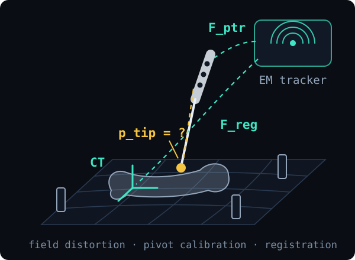

# Stereotactic Navigation: Calibration & Distortion Correction

Surgical navigation only helps if the system knows exactly where the instrument tip is. Electromagnetic tracking readings are distorted, so this project calibrates the pointer and corrects the field distortion to locate the tip in CT coordinates to within a millimeter.

  
   
  The problem: find the pointer tip in CT coordinates through a distorted tracking field.

## Highlights

- **Distortion correction.** Fits a 5th-degree Bernstein (Bézier volume) polynomial that maps distorted tracker readings back to true positions.
- **Calibration and registration.** Pivot calibration for the pointer tip and 3D point-cloud registration from the tracker frame to the CT frame.
- **Sub-millimeter result.** Corrected tip positions stay within 0.86 mm of ground truth across all six validation datasets.
- **Validated end to end.** Automated tests for the interpolation package and error statistics with visual checks against the given ground truth.

## Report

The method, math and full error tables are in the [report (PDF)](report.pdf). The code is not public because it is a course solution (Computer Integrated Surgery I, Johns Hopkins University); I'm happy to walk through it.

## Team

Austin Huang and Danny Chang.

More projects: [austinhuang823.github.io](https://austinhuang823.github.io)
